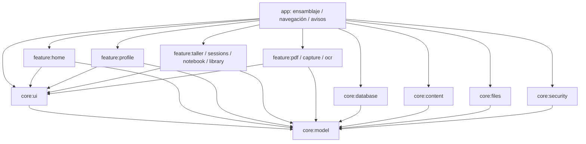

# Arquitectura y contratos

Una APK, `pe.profelab.app`; Kotlin + Compose. Inyección por constructores en `AppGraph`, sin localizadores globales en las features. `MainActivity` solo configura Android y monta la UI. `ProfeApp` ensambla navegación y callbacks; no contiene SQL ni lógica PDF/OCR/curricular.

| Módulo | Responsabilidad / API | Estado H1 |
|---|---|---|
| `:app` | Navegación, AppGraph, permisos notificación, WorkManager | Implementado en fuente |
| `:core:model` | UUID, Profile, Task, ActivityEvent, Draft, SourceReference, HomeRules, interfaces | Implementado |
| `:core:database` | Room v1, DAO, repositorio transaccional, DataStore | Implementado; ejecución Android pendiente |
| `:core:ui` | Tema, cards, estados, libro/planta Canvas, factoría ViewModel | Implementado |
| `:core:files` | Copia privada limitada con SHA-256 y archivo temporal | Primitiva escrita; sin importador H1 |
| `:core:content` | Lectura estricta del catálogo JSON V2 | Implementado; instalación de packs pendiente |
| `:core:security` | Lista de dominios oficiales y validación básica de rutas relativas | Implementado; no sustituye validación completa de packs |
| `:feature:home` | Inicio, listas, editor y borradores de tareas, actividad | Implementado |
| `:feature:profile` | Perfil, borrador, preferencia y créditos | Implementado |
| `:feature:taller` | Raíz y selección Materiales/Experimentos/Mis ideas | Estado de próxima versión; desarrollo H2 |
| `:feature:sessions` | Destino independiente | Estado de próxima versión; H3 |
| `:feature:notebook` | Raíz y selección Apuntes/Prácticas/Ideas | Estado de próxima versión; H4 |
| `:feature:library` | Consulta de referencias y ficha | Parcial; importador/lector H5 |
| `:feature:pdf` | Frontera para OpenDocument y anotaciones | Módulo reservado H5 |
| `:feature:capture` | Frontera DocumentCapture | Módulo reservado H6 |
| `:feature:ocr` | Frontera OcrEngine y revisión | Módulo reservado H6 |

Cada feature depende solo de core. Los imports y el grafo se comprueban en `scripts/verify_project.py`. Se incluyen módulos reservados reales, no se disfrazan como motores implementados.

## Contratos de ampliación

`Repositories.kt` define TaskRepository, ProfileRepository, ActivityRepository, DraftRepository, PreferencesRepository, EducationalSourceRepository y ReminderScheduler. UI accede a Flow/objetos de dominio, sin clases Room. Los métodos de repositorios H1 lanzan errores que los ViewModels convierten en estados visibles; las interfaces futuras devuelven `Outcome` tipado.

`FeatureContracts.kt` define ProjectCatalog, FindMaterialProjects, InventoryResolver, OpenDocument, AttachResource, AddObservation, PdfAnnotationRepository, OcrEngine, DocumentCapture, ContentPackInstaller y BackupService. No hay implementaciones vacías que devuelvan éxito falso. No se registran como disponibles en H1. La preview de backup necesita un tipo específico más detallado en H7; la interfaz actual es una frontera inicial versionada, no un esquema de respaldo comprometido.

Vínculos `EntityRef(kind,id)`, nunca títulos/rutas como identidad. Anotaciones con documento/hash/página 0-based, puntos normalizados y origen semántico/manual/OCR revisado. Las entidades de dominio futuras detalladas se incorporarán por hito sin convertirlas prematuramente en tablas vacías.

## Persistencia y cambios

Room contiene `tasks`, `profiles`, `drafts`, `activity`; perfil único en slot 1 con UUID. Guardar/completar/eliminar escribe actividad dentro de transacción. Editar una tarea no pisa un cambio de completado concurrente. Borradores se escriben secuencialmente y se eliminan al confirmar/descartar. Las notificaciones se reconcilian a partir de la base: eliminación o completado invalida el aviso y el Worker revisa la tarea otra vez antes de notificar.

Preferencias en DataStore. Almacenamiento de futuros documentos en `filesDir/documents` con nombres UUID, tamaño máximo y hash; ningún archivo externo se importa en H1. Los metadatos MINEDU se leen de assets, sin mutar la fuente ni inventar disponibilidad.

Próxima modificación Room: conservar schema 1 generado, aumentar versión, migración explícita, prueba MigrationTestHelper con snapshot, test de reapertura y recuperación. Nunca `fallbackToDestructiveMigration`. Nuevos packs deben separar plantillas inmutables de `UserProject` con ID nuevo y `forkedFromTemplateId`, y respetar rollback/idempotencia.
